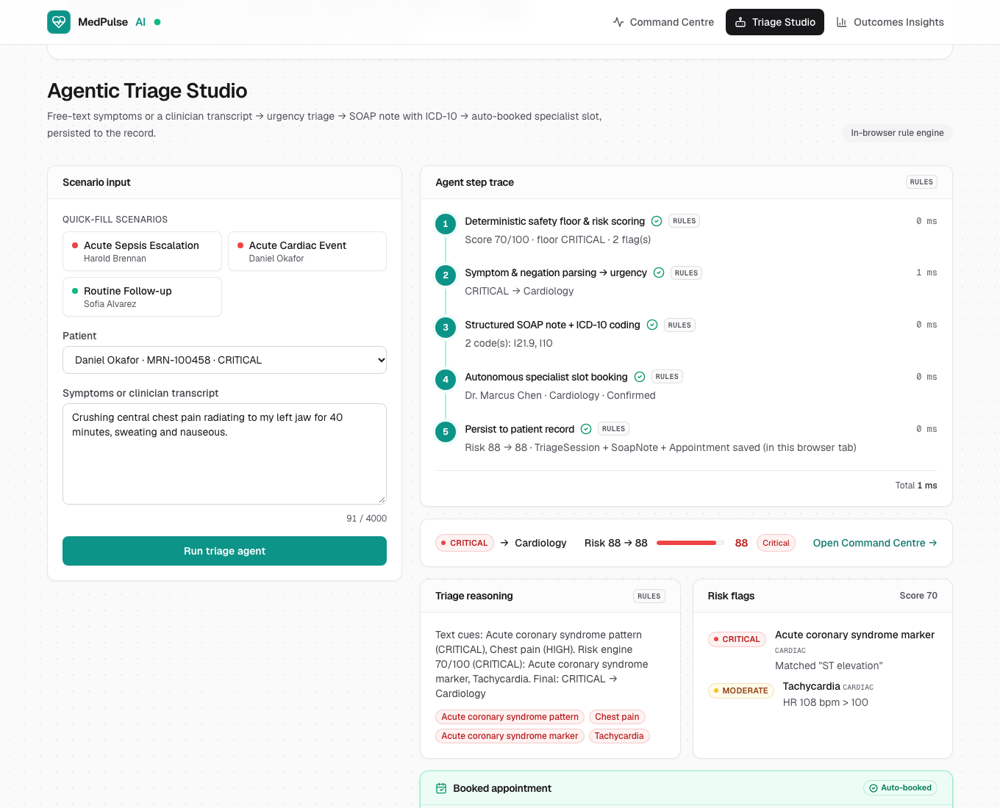
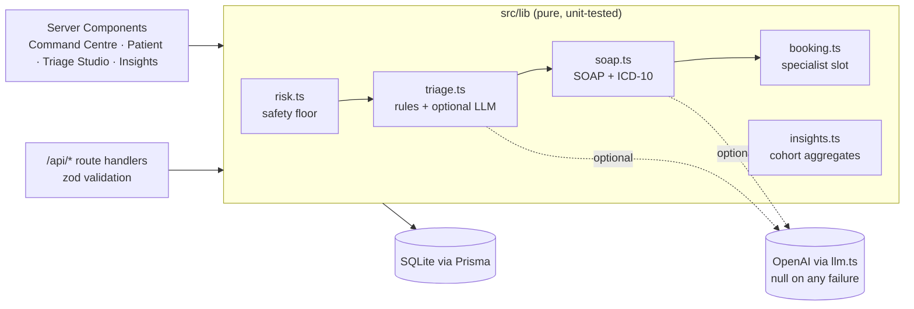

# MedPulse AI: Clinical Command Centre

[](https://github.com/MohamedAtiyah/Hackathon-UOWD-MedPulse/actions/workflows/ci.yml)


[](LICENSE)

> **Clinical decision support, not a diagnosis.** All patient data is synthetic.

**[▶ Try the live demo](https://mohamedatiyah.github.io/Hackathon-UOWD-MedPulse/)** (runs in your browser, no sign-up)

[](https://mohamedatiyah.github.io/Hackathon-UOWD-MedPulse/)

Built for the UOWD Hackathon, Medical AI track.

MedPulse AI turns vitals, clinician findings (including imaging reports) and free-text symptoms into a
risk-ranked patient list, an urgency decision, an auto-booked specialist slot and a SOAP note with
ICD-10 codes. A cohort dashboard then shows which protocols and patient groups drive readmissions.
It runs fully offline on a deterministic rule engine. An LLM (OpenAI) is optional: it can add nuance and escalate,
but it can never lower urgency.

## What this project demonstrates

- **Safety-floor AI design:** a deterministic rule engine sets the minimum urgency, and the LLM can only escalate it, never lower it.
- **A traced agent pipeline:** risk → triage → SOAP + ICD-10 → booking, with every step timed and labelled, saved in one database transaction.
- **Validated LLM output:** OpenAI structured outputs are checked with zod, and any failure falls back to the rules.
- **Full-stack TypeScript:** Next.js 16 Server Components, thin API routes, Prisma + SQLite.
- **Tested logic:** pure `src/lib` modules with unit tests, run with lint, typecheck and build in CI.

The [live demo](https://mohamedatiyah.github.io/Hackathon-UOWD-MedPulse/) is a browser port of the rule engine. The full app is Next.js + Prisma + OpenAI.

## Features

| Capability | Route | What it does |
|---|---|---|
| **Diagnostic support**: flag risks/conditions from patient data and imaging | `/` Command Centre, `/patients/[id]` | Re-scores every patient on load from vitals plus documented findings (sepsis/SIRS, ACS markers, hypoxaemia, lactate, imaging red flags). Each flag shows the rule and value that triggered it. |
| **Agentic AI assistant**: triage symptoms, book appointments, summarise SOAP notes | `/agent` Triage Studio | One input runs a 5-step traced agent: safety floor → negation-aware triage → SOAP + ICD-10 → specialist booking → saved to the record. Four one-click scenarios. |
| **Clinical insights**: spot patterns in patient outcomes | `/insights` Outcomes Insights | Protocol recovery vs 30-day readmission, readmission risk clusters, length of stay, live urgency mix, department load and risk distribution. |

A 2-minute walkthrough is in [docs/DEMO.md](docs/DEMO.md).

## Quickstart

```bash
npm install
cp .env.example .env && npm run db:push && npm run db:seed
npm run dev        # http://localhost:3000
```

Optional: set `OPENAI_API_KEY` in `.env` (model via `OPENAI_MODEL`, default `gpt-4o-mini`) to enable LLM-assisted triage and SOAP notes.
Every feature works without it.

## Architecture



| Layer | Files | Notes |
|---|---|---|
| UI | `src/app/**/page.tsx`, `src/components/ui.tsx` | Server Components read the DB through `src/lib` directly. Only the Triage Studio form is a client component. |
| API | `src/app/api/{agent,patients,insights}` | Thin handlers that parse, validate with zod, call lib and return JSON. 400/404/500 with `{ error }`. |
| Agent | `src/lib/agent.ts` | Orchestrates risk → triage → SOAP → booking, then writes TriageSession, SoapNote and Appointment and updates the patient in one transaction. |
| Rules | `src/lib/risk.ts`, `triage.ts`, `text.ts`, `soap.ts`, `booking.ts` | Deterministic, explainable, offline. |
| LLM | `src/lib/llm.ts` | Structured output validated by zod. Missing key, timeout, refusal or bad JSON returns `null`, and the rules take over. |
| Data | `prisma/schema.prisma`, `prisma/seed.ts` | 6 synthetic patients, triage history, SOAP notes, appointments and 5 outcome benchmarks. |

More detail: [ARCHITECTURE.md](ARCHITECTURE.md).

## Clinical safety floor

1. **Rules run first.** `evaluateRisk` scores vitals and findings into a level (LOW → CRITICAL) before any
   AI is involved. Triage can never be lower than this floor.
2. **The LLM can only escalate.** Final urgency = `max(rule level, LLM level)`, and the department follows the
   LLM only when it escalates. Unit-tested in `src/lib/triage.test.ts`.
3. **Negation-aware.** "no wheeze today" is ignored and shown in the trace. Negation stops at a comma, "but"
   or "and", so "no fever and crushing chest pain radiating to my left arm" still triages CRITICAL.
4. **Explainable.** Every flag carries its triggering value, and every agent step shows its source
   (`RULES` or `LLM`) and timing.
5. **Safe failure.** Invalid input returns 400, an unknown patient returns 404, and any LLM failure falls back to
   rules silently for the user and is logged by error class only (no patient text, no keys).
6. **Disclaimer everywhere.** The root layout banner appears on every screen, and every SOAP plan ends with a
   clinician-review disclaimer.

## Scripts

| Command | Purpose |
|---|---|
| `npm run dev` / `npm run build` / `npm start` | Develop / production build / serve |
| `npm test` | Unit tests for risk, triage, negation, SOAP, booking, insights (`node:test`) |
| `npm run typecheck` · `npm run lint` | `tsc --noEmit` · ESLint |
| `npm run db:push && npm run db:seed` | Sync the schema and restore the clean demo data |

## Stack

Next.js 16 (App Router, Cache Components) · React 19 · TypeScript strict · Tailwind CSS 4 · Prisma 6 + SQLite ·
zod · OpenAI SDK (optional) · lucide-react.

## Scope and limits

Synthetic data only. Booking is simulated. No auth, EHR/FHIR integration or PHI handling. The API has no
authentication, so add it before any public deployment. Negation and symptom matching are keyword-based;
a production version would use a clinical NLP model.
